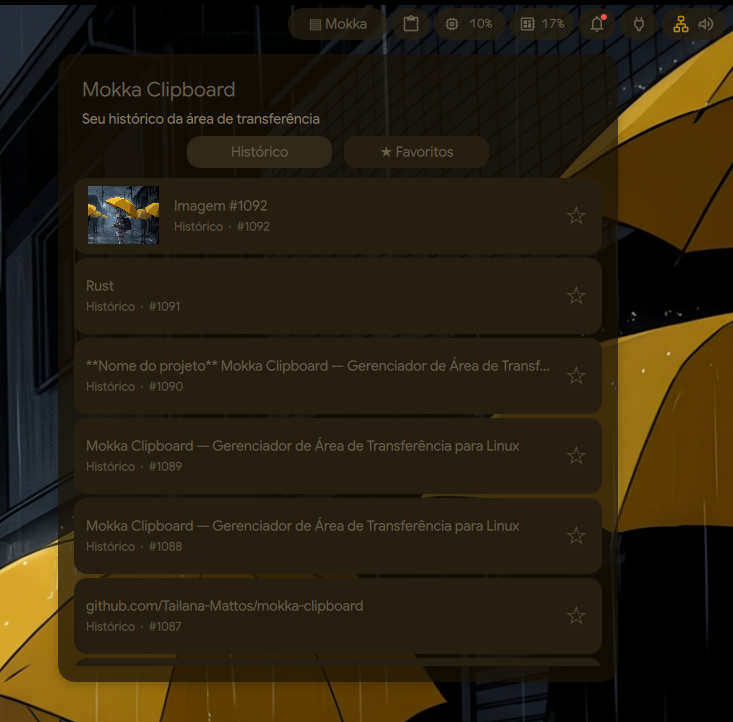

# Mokka Clipboard

**A native clipboard manager for Linux, written in Rust.**



Mokka Clipboard is a clipboard history manager designed for Linux desktop environments. It stores text and image entries, supports favorites and search, and provides keyboard-driven navigation through clipboard history.

## Features

- Text and PNG image history.
- Persistent storage using SQLite.
- Image thumbnails and local cache.
- Favorites and unfavorites.
- Search through clipboard history.
- Restore previously copied entries.
- Navigate between previous and next entries.
- JSON output for external integrations.
- Unix socket IPC communication.
- Background daemon.

## Technologies

- Rust (Edition 2024)
- SQLite
- rusqlite
- lamco-data-control
- serde_json
- image

## Requirements

- Linux
- Rust and Cargo
- Compatible graphical clipboard environment.

## Build

```bash
git clone https://github.com/USERNAME/mokka-clipboard.git
cd mokka-clipboard
cargo build --release
```

## Usage

Start the background daemon:

```bash
mokka-clipboard --daemon
```

Available commands:

| Command | Description |
|---|---|
| `--daemon` | Start the clipboard daemon |
| `--list` | Display recent entries |
| `--list-json` | List entries in JSON format |
| `--search "term"` | Search clipboard history |
| `--favorites` | List favorite entries |
| `--favorite ID` | Add an entry to favorites |
| `--unfavorite ID` | Remove an entry from favorites |
| `--restore ID` | Restore a clipboard entry |
| `--previous` | Restore the previous entry |
| `--next` | Restore the next entry |

## Data storage

- Database: `~/.local/share/mokka-clipboard/mokka.db`
- Image thumbnails: `~/.cache/mokka-clipboard/thumbnails/`

## Project status

Mokka Clipboard is under active development.

The core daemon, clipboard capture, SQLite storage, history operations, favorites, search, image thumbnails and IPC commands are implemented.

Desktop interface integration is still evolving.

## License

MIT License

---

# Mokka Clipboard (Português)

**Gerenciador nativo de histórico da área de transferência para Linux, desenvolvido em Rust.**

O Mokka Clipboard é um gerenciador de histórico da área de transferência desenvolvido para ambientes Linux. Armazena textos e imagens, permite favoritar e pesquisar entradas e oferece navegação pelo histórico utilizando atalhos de teclado.

## Funcionalidades

- Histórico de textos e imagens PNG.
- Armazenamento persistente com SQLite.
- Miniaturas de imagens e cache local.
- Sistema de favoritos.
- Pesquisa no histórico.
- Restauração de conteúdos copiados anteriormente.
- Navegação entre entradas anteriores e próximas.
- Saída JSON para integrações externas.
- Comunicação IPC por socket Unix.
- Execução em segundo plano como daemon.

## Tecnologias

- Rust (Edition 2024)
- SQLite
- rusqlite
- lamco-data-control
- serde_json
- image

## Requisitos

- Linux
- Rust e Cargo
- Ambiente gráfico com suporte à área de transferência compatível.

## Compilação

```bash
cargo build --release
```

## Utilização

Iniciar o daemon:

```bash
mokka-clipboard --daemon
```

Consultar o histórico:

```bash
mokka-clipboard --list
```

Consultar em JSON:

```bash
mokka-clipboard --list-json
```

Pesquisar:

```bash
mokka-clipboard --search "termo"
```

Consultar favoritos:

```bash
mokka-clipboard --favorites
```

Favoritar uma entrada:

```bash
mokka-clipboard --favorite ID
```

Restaurar uma entrada:

```bash
mokka-clipboard --restore ID
```

Navegar pelo histórico:

```bash
mokka-clipboard --previous
mokka-clipboard --next
```

## Armazenamento

- Banco de dados: `~/.local/share/mokka-clipboard/mokka.db`
- Miniaturas: `~/.cache/mokka-clipboard/thumbnails/`

## Estado do projeto

O núcleo do Mokka Clipboard está implementado e em desenvolvimento contínuo.

O projeto já conta com captura de conteúdo, persistência SQLite, histórico, favoritos, pesquisa, miniaturas e comunicação IPC.

A integração com interface gráfica ainda está em evolução.

## Licença

MIT
